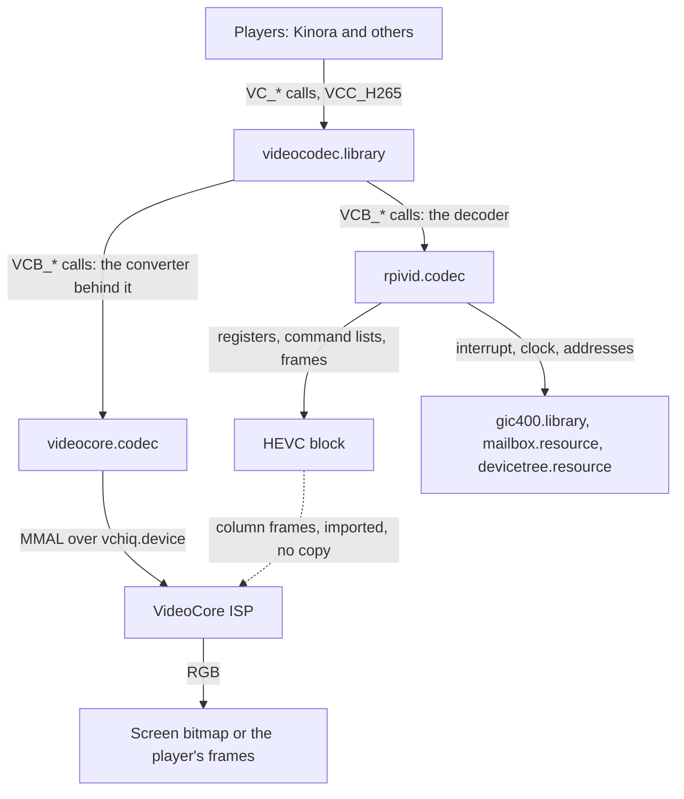
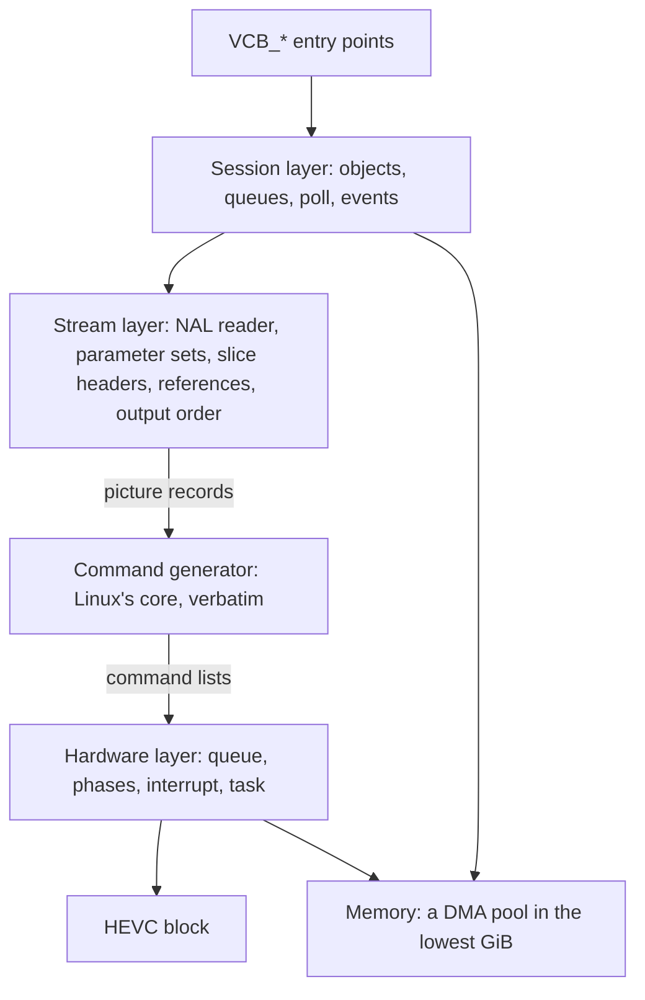
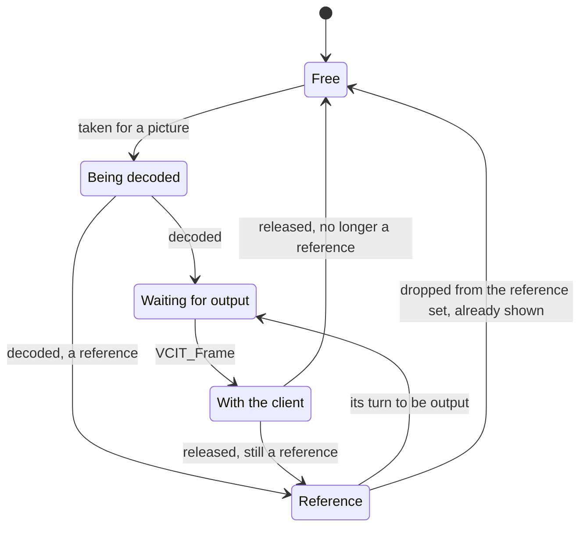
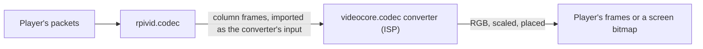

# rpivid.codec: architecture

How H.265 video reaches the screen of an Amiga on a PiStorm: a backend of
`videocodec.library` driving the Raspberry Pi 4's HEVC block, and the
frontend's part in showing what it decodes. Sections 1 to 4 give the
components, tasks, ownership and data paths; sections 5 to 11 each layer's
design and the rules it keeps; the source has the rest. The standard is
cited by clause from ITU-T H.265 V11 (01/2026). The measured hardware is in
[hardware-facts.md](hardware-facts.md), the tests in the developer guide
(section 4).

Memory sizes are for 1920x1080 (coded as 1920x1088: 15 columns of 1632
lines) unless said.

---

## 1. The layers



| Binary | Installed in | What it is |
|---|---|---|
| `rpivid.codec` | `LIBS:videocodec/` | The backend: one codec row, `VCC_H265` decoder, hardware priority. Reads the stream, keeps the reference pictures, drives the block, hands out frames in the block's column layout. |
| The chain | `videocodec.library` (videocodec-library) | A converter session placed behind a decoder whose output the client cannot take (section 4). |

Each layer sees only the public header of the layer below. `rpivid.codec`
is built against `libraries/videocodec_backend.h`, `emu68-common` and the
protos of the three resources; nothing of VCHIQ, MMAL or `videocore.codec`
reaches it. The frontend keeps knowing no hardware: the chain is a rule over
codec rows.

---

## 2. What the block offers

The HEVC block ("rpivid", `brcm,bcm2711-hevc-dec`) is a register-programmed
engine beside the VideoCore, "not part of the VideoCore GPU": the firmware
neither drives it nor stands in the way. Under Emu68 it needs nothing new:
its registers are mapped, its clock already runs at 500 MHz, its interrupt
reaches a `gic400.library` server in under 150 us ([hardware-facts.md](hardware-facts.md)).

* **It is stateless.** It knows nothing of the stream: the host reads every
  header, resolves the reference pictures, decides the output order and
  writes, per picture, a command list and the addresses of the current and
  reference frames. The block strips emulation-prevention bytes itself, so
  slice data goes in as it is in the stream.
* **It decodes in two phases,** each with its own interrupt source. Phase 1
  (entropy decoding) reads the command list and the slice data and writes
  coefficient and prediction-unit streams into two scratch buffers. Phase 2
  (reconstruction) reads those, the reference frames and the collocated
  motion vectors and writes the picture. Phase 1 of the next picture runs
  while phase 2 of this one does, so two pictures are in the block at once.
* **It reaches all RAM** by 64-byte-granular addresses, so every buffer is
  ordinary Fast RAM, cacheable, and emu68-common's DMA cache contract applies.
* **It writes one layout:** 128-byte-wide columns, the luma rows then the
  interleaved chroma rows, 8-bit or 10-bit samples; the depth is the
  stream's, there is no 8-bit output for a Main10 stream. The VideoCore's
  ISP reads the 8-bit layout from an imported frame at 200 pictures/s at
  1080p, in full range. The 10-bit one it does not read, and no other VPU
  path does: Linux's ISP driver offers the 8-bit layout only, and Linux
  shows 10-bit pictures through the display hardware or narrows them to 8
  bits in software. Here the display hardware is P96's, so Main10 takes the
  68k pass of section 10.
* **Its limits,** as Linux's driver refuses them: 4:2:0 only, 8 or 10 bits,
  16 to 4096 pixels each way, 16 reference slots.
* **It is fast.** Measured here on the CM4: about 340 pictures/s at 1080p
  and 82 at 4K (the suite's baselines); RISC OS, with the same command
  generator, measured 353 and 83. The 68k's parsing and the ISP's conversion
  are the budget, not the block.

---

## 3. rpivid.codec

### 3.1 Structure



* **The session layer** is the backend ABI: sessions, their packet and frame
  objects, the items a poll returns, the events, the signals. It knows the
  stream only as packets going in and frames coming out in order.
* **The stream layer** turns packets into pictures: it finds the NAL units,
  keeps the parameter sets, reads each slice header, derives the picture
  order count, the reference picture sets and the reference lists, keeps the
  decoded picture buffer and runs the output ("bumping") process, so that
  frames leave in display order. Its product per picture is a **picture
  record**: Linux's V4L2 stateless HEVC control structures (the parameter
  sets, the slice parameters, the decode parameters with the DPB, the
  scaling matrix), filled as FFmpeg fills them for the same hardware. Written
  from the standard's clauses 7 and 8, with FFmpeg and Linux as the
  behavioural reference.
* **The command generator** is the hardware knowledge of Linux's
  `hevc_d_h265.c`, kept verbatim so it diffs against upstream: from a picture
  record and the frames' addresses it writes the phase-1 command list (the
  probability tables, the scaling factors, the bitstream window, each slice's
  registers and entry points, tiles and wavefronts) and the phase-2 register
  values.
* **The hardware layer** owns the block: one queue of pictures ready to
  decode, from every session; the two scratch buffers of each queue slot;
  the interrupt server and the task that runs the phases and retires
  pictures.
* **The picture record is the contract** between the stream layer and the
  rest. It is a published kernel interface, so it is stable, documented, and
  the same thing FFmpeg produces on a Linux host: each half can be tested
  without the other (section 12).

| Layer | Files |
|---|---|
| The module | `src/rpivid_lib.c` (the resident, open, close, expunge, the function table), `src/rpivid_backend.c` (the sixteen `VCB_*` entry points: the session looked up and locked, the session layer called), `src/rpivid_codecs.c` (the codec row), `include/rpivid_private.h` (the library base and the hardware layer's state, shared by the files) |
| Session | `src/session.h` (the session and its objects), `src/session.c` (open, close, imports, sends, poll, release, flush), `src/session_objects.c` (packets, frames, a shape's memory), `src/session_parse.c` (the scanner over packets, the units, a picture's build and its hand-over to the block) |
| Stream | `src/stream/`: `nal.c` (the Annex B scanner), `bits.c` (the bit reader), `ps.c` (the parameter sets), `slice.c` (the slice segment header), `rps.c` (picture order count, the reference picture set, the reference lists), `dpb.c` (the decoded picture buffer and the output process), `record.c` (the picture record), `stream.c` (the layer's state and the order of a picture's steps) |
| Command generator | `src/cmdgen/`: `hevc_d_h265.c` (Linux's, kept), `cmdgen.c` (our plumbing, compiled into its translation unit), `hevc_d.h`, `hevc_d_hw.h`, `hevc_d_video.h`, `hevc_d_h265.h` (Linux's headers, trimmed), `linux_compat.h` (the kernel's names the kept code uses), `UPSTREAM` (the commit and blobs it comes from) |
| The picture record | `include/v4l2_hevc_ctrls.h`: the HEVC part of Linux's `v4l2-controls.h`, taken under BSD-3-Clause |
| Hardware | `src/hw/`: `hw.c` (claim, clock, registers, up and down, the reset guard's prepare), `hw_isr.c` (the interrupt server, assembly), `hw_task.c` (the decode task) |
| Main10 | `src/narrow/narrow.S` (the narrowing pass, assembly), `narrow.h` |

The stream layer and the command generator make no Exec call of their own;
the stream layer builds on the host (section 12).

### 3.2 Tasks and locks

| Task | Does |
|---|---|
| The caller's | Every `VCB_*` call. A send parses the packet's NAL units, copies slice data into the picture's own bitstream buffer, and when a picture is complete builds its record and command list and queues it. A poll hands out what is ready, narrowing a Main10 picture to 8 bits first (section 10). The 68k's share of a picture is done here, in the player's own time: about 0.7 ms at 1080p, the library's calls included ([hardware-facts.md](hardware-facts.md)). |
| The decode task | Only the block: starts phase 1 of the next queued picture when the entropy stage is free, phase 2 when the reconstruction stage is, reads each phase's result when its interrupt comes, grows a scratch buffer that ran out and reruns, retires a finished picture and signals its session's task. Never parses, never runs client code. |
| The interrupt server | Reads and clears the block's interrupt register and signals the decode task. Assembly, answering with the Z flag as the Emu68 drivers' servers do. |

| Lock | Held for | Why |
|---|---|---|
| The library's session list | finding a session for a call, opening and closing one, bringing the block up and down | the list and the block's life are every session's |
| A session's | each `VCB_*` call of the session | one stream state per session; only the caller's task works on it |
| The hardware queue's | queueing a picture; the task taking one; the slots and the pictures' states | short, never held across a wait |

A call finds its session under the list's lock, takes the session's, lets
the list's go and runs. A close takes the list's lock, unlinks the session,
takes the session's (so a call in flight finishes first) and tears down;
its pictures in the block are waited for (section 8.4) before the frames go.

The decode task takes no session's lock. It meets the caller at the
hardware queue, and hands a finished picture back through one field and a
signal; the caller's next call does the rest. The interrupt server shares
nothing with the task either: it tells it that a phase ended by that
phase's signal, which `Wait()` hands over whole.

No session waits on another: a session's frames are its own, the block is
shared picture by picture, and the queue is served in arrival order.

### 3.3 A picture's path

```mermaid
sequenceDiagram
    participant C as Client
    participant S as Stream layer (caller's task)
    participant T as Decode task
    participant B as Block
    C->>S: VC_SendPacket()
    S->>S: NAL units; parameter sets kept; slice header read; slice data copied
    S-->>C: VCIT_PacketReturned (at the next poll)
    Note over S: the next picture's first slice ends this one
    S->>S: references resolved, a free frame taken, output order decided, record and command list built
    S->>T: picture queued
    T->>B: phase 1: scratch buffers, command list
    B-->>T: interrupt: entropy done
    T->>B: phase 2: frame, references, collocated vectors
    B-->>T: interrupt: picture written
    T->>S: picture retired; Signal()
    C->>S: VC_Poll()
    S-->>C: VCIT_Frame, in output order
    C->>S: VC_ReleaseFrame()
```

* **A send** queues the packet and parses everything sent so far, as far
  as the frames and buffers go. Each NAL unit is gathered whole into the
  session's unit buffer, which starts at 256 KiB and doubles up to 16 MiB:
  a packet with no unit's end within 16 MiB is no Annex B stream. Then a
  parameter set is kept, an SEI, a delimiter or filler data skipped, an end
  of sequence or of bitstream ends the picture, and a slice goes into its
  picture.
* **Packets return at once.** Slice data is copied into the backend's own
  bitstream buffer for the picture, so a packet is the client's again as
  soon as it is parsed, whatever memory it is in (Chip RAM, an unaligned
  file buffer) and however it is cut (framed or any chunks). A 1080p picture
  is some tens of kilobytes; the copy is noise beside the parsing.
* **The copy.** Each slice's NAL unit goes into the bitstream buffer whole,
  header and emulation-prevention bytes included, with no start code, each
  at a 4-byte boundary: what the block reads. The buffer starts at Linux's
  size for the picture (768 KiB at 1080p, 3 MiB at 4K) and grows by Linux's
  steps up to 16 MiB; a picture larger than that is dropped.
* **A picture is complete** at the first slice of the next one, at a unit
  that can only start an access unit (section 6), at an end of sequence or
  stream, at a packet flagged `VCPF_FrameEnd` or `VCPF_EndOfStream`, or at
  the end of a packet of a `Framed` session, unless that packet is part of a
  picture spread over several: from one flagged `VCPF_FrameStart` alone to
  the one flagged `VCPF_FrameEnd`, as a player sends a picture larger than
  its packets. The output order is decided then, by the standard's bumping
  process, and is a property of the frames: each session's output queue is
  a list of frames in display order, each marked decoded or not. The poll
  hands out from its head while the head is decoded. So pipelining never
  reorders, and a picture the block has not finished holds the ones behind
  it.
* **Pictures overlap** three deep, as Linux runs them: one being parsed in
  the caller's task, one in phase 1, one in phase 2, each with its own
  bitstream buffer and command list. When all three are busy, or no frame
  is free for the next picture, parsing stops at that picture's first slice
  and holds the unit; the rest of its packet waits. The next call after the
  task retires a picture or the client releases a frame goes on with it:
  the resume happens in the client's call, never in the task.
* **Timestamps** travel with the picture: a frame's `Pts` is the packet's
  that held the picture's first slice.

### 3.4 Frames and memory

A frame is a buffer in the block's column layout, 128-byte columns of
16-aligned luma rows and the interleaved chroma rows after them: the layout
the block writes and the ISP implies from a width and a height. A session's
frames are made at the first parameter set, as many as the stream's decoded
picture buffer needs plus what the client may hold, and remade when the
stream changes shape, once the client has given every frame back.



A frame is free when it is neither a reference nor out with the client; the
two conditions are independent, so a picture can be shown while it is still
referenced and referenced while the client holds it.

| What | Owner | Who touches it | Cache work |
|---|---|---|---|
| Frames (Main) | the session | the block writes, the ISP reads, a client may read | allocation leaves no line dirty; the poll invalidates each picture before it goes out, so a client that reads it sees what the block wrote |
| Frames (Main10) | the session | the block writes, the 68k reads | allocation leaves no line dirty; the poll invalidates each before the pass |
| Narrowed frames (Main10), one per picture out with the client | the session | the 68k writes, the ISP reads | cleaned by the converter at its import, as any picture a client writes |
| Bitstream buffers, one per picture in flight | the session | the 68k writes, the block reads | cleaned before phase 1 |
| Command lists, one per picture in flight | the session | the 68k writes, the block reads | cleaned before phase 1 |
| Coefficient and prediction-unit buffers, per queue slot | the hardware layer | the block only | none; grown and rerun when phase 1 reports them exhausted |
| Collocated motion vectors, one per frame | the session | the block only | none |
| Parameter sets, reference books, records | the session | the 68k only | ordinary memory |

Everything the ISP reads comes from a DMA pool over Emu68's Fast RAM, kept
to the regions wholly within the lowest GiB, as `videocore.codec`'s is (a
region is handed out as a whole, so one that crosses the line is left out),
on whole cache lines: so the ISP imports every frame and reads it in place,
and nothing is ever bounced. The block reaches all RAM, so what only it and
the 68k touch may come from anywhere. At 1080p a frame is 3.1 MB and a
slot's scratch pair 2.5 MB; a session whose stream buffers six pictures,
with three frames for the client, takes about 32 MB and the block's three
slots 7.5 MB, a 4K one about four times both (section 9).

**Main10** is the one place a pixel goes through the 68k. The block writes
10-bit columns (three samples in each 32-bit word, 96 samples to a column)
and nothing on the VPU reads them (section 2), so the poll narrows each
picture that is ready for the client into an 8-bit frame of the same
layout, which goes out as a Main picture would, through the same chain
(section 4); the 10-bit frame stays the reference. A 1080p picture is 4.2 MB
read, 3.1 MB written and a million words unpacked, in the client's task, in
assembly. Measured: 6.1 ms per 1080p picture on the CM4
([hardware-facts.md](hardware-facts.md)), a sixth of a 25 pictures/s frame
period, but some 25 ms at 4K. So Main10 is offered up to 1080p and refused
past it, as any limit is (section 11).

### 3.5 Errors and bad streams

Section 11 lists every check; in outline:

* **Refused at the parameter set:** chroma other than 4:2:0, a bit depth
  other than 8 or 10, a picture past 4096 pixels, a Main10 picture past
  1080p (section 3.4). With the parameter sets in
  `VCA_Extradata` the open refuses; in the stream, the session reports
  `VCEV_Error` and stops.
* **A slice the parser cannot read** drops its picture: the frame it would
  have filled stays what it was, the references go on, and the next random
  access point sets everything right. A packet flagged corrupt is dropped the
  same way. Nothing reaches the block that the parser did not understand.
* **Phase 1 that ends badly** (the block's status says so) drops the picture
  too. Phase 1 that ran out of scratch space is not an error: the buffer
  grows and the picture runs again, as Linux does.
* **A phase that never completes** means a wedged block. The session gets
  `VCEV_Error`; the block has no reset line, and whether turning its clock
  off and on recovers it is to be found out (section 15).
* **Closing a session** waits for its pictures in the block: a phase cannot
  be abandoned while the block may still write the frame.

### 3.6 Resets

A 68k reset restarts AmigaOS while the block may still be writing a frame
into memory the next instance reuses. `rpivid.codec` installs a reset guard
from `emu68-common`, as `videocore.codec` does: it stops queueing, waits a few
milliseconds for the pictures in the block, and leaves the block idle
(section 8.4). A hardware reset reboots the Pi and the block with it.

---

## 4. The chain: showing the pictures

No player can draw a column frame, and the 68k must not convert it (a
Main10 picture is narrowed, not converted: it leaves the backend as 8-bit
columns, section 10). The converter that reads the layout is
`videocore.codec`'s ISP session.
The frontend places it behind the decoder, and the player sees one session:



* **The rule.** A decoder session asks a backend row for a codec. When that
  row does not write the output format the client asked for, the frontend
  looks for a converter row that reads the row's native format and writes
  the client's, opens the decoder with its native output, and when the
  stream's shape arrives opens the converter with that shape on its input
  and the client's format, size, pitch, place and aspect on its output. The
  rule is general: a software decoder writing I420 gets the same chain to
  RGB.
* **Objects.** The decoder's frames become the converter's input frames by
  import, so no pixel is copied: the ISP reads the decoder's memory. The
  converter takes imports only before its first send, so the frontend asks
  the decoder for its frames (`VCB_OutputFrame()`, backend ABI 1.1) when
  the shape arrives and imports them all at once. The
  converter's output frames are the client's imported ones or the converter
  backend's own, exactly as a converter session has them today. The client
  gets the converter's items as frames and the decoder's as packets.
* **The pump** runs inside `VC_Poll()`, in the client's task: it polls the
  decoder, sends each frame to the converter, gives the converter's returned
  input frames back to the decoder, and hands the converter's output to the
  client. Both backends signal the client's task, so the client's loop wakes
  as before. No task is added and no library code runs outside the client's
  calls.
* **Geometry.** `VCEV_StreamInfo` reaches the client with the converter's
  output format. A change of output size or place goes to the converter; a
  change of the stream's shape remakes the converter, as a shape change
  remakes a decoder's frames today.
* **Cost.** One more picture of latency (the ISP's), and the ISP's 5 ms per
  1080p picture on the VPU, not the 68k. With the block at about 3 ms and
  the 68k's parsing beside it, 1080p at 60 pictures/s has room.

Everything of the chain is in videocodec-library (BSD), with the column pixel
format it already carries; nothing of this repository goes there.

---

## 5. The backend's face

### 5.1 The library and its life

`rpivid.codec` is an Exec library whose function table is
`videocodec_backend.sfd`, built as `videocore.codec` is: freestanding C over
`emu68-common`, its module layout (the do-not-execute stub at
offset 0, the romtag next, no writable section) and LTO. Everything mutable
lives in the library base: the session list and its lock, the DMA pool, the
hardware layer's state, the reset guard, the counters.

* **Opening the library** touches no hardware.
* **The first session** brings the hardware up, under the session list's
  lock: the pool, the claim, the clock, the decode task, the interrupt
  server (section 8.1), then the reset guard.
* **`VCB_Idle()`** (the frontend's last close, no session open) takes it
  down again the same way: the server removed, the task joined, the
  interrupt register and the clock put back as found, the slots freed, the
  claim released, the pool shrunk.
* **Expunging** is refused while the library is open, a session is left,
  the hardware is up, or a later patch of `ColdReboot()` keeps the reset
  guard in place; then the pool is deleted and the base freed.

### 5.2 What it reports

`VCB_QueryCodec()` has one row where the device tree has the block and none
where it has not (asked once, at the first query, in the caller's task):
`VCC_H265`, `VCK_Decoder`, 4096x2304 (the largest 16:9 picture within the
block's 4096 each way), level 51 (4K at 60), priority
`VCB_PRIORITY_HARDWARE`, `VCCF_Session`, the output format
`VCF_NV12_COL128` and no input formats. `VCB_Image()` answers
`VCERR_UNSUPPORTED`.

`VCB_GetInfo()` reports ABI 1.1 (`VCB_OutputFrame()`), the interface
`"HEVC 0x202"` (the block's version) while the hardware is up, and six
counters: `pictures` (queued for the block), `dropped` (section 11),
`narrowed` (section 10), `reruns` (phase 1 run again after a scratch buffer
grew), `interrupts` and `wedged`.

### 5.3 Sessions and their objects

A session holds a copy of its parameters (the extradata is not kept), the
task and signal it tells, its state (open, streaming, ended or failed, with
the failure's code), the stream layer's state, the command generator's
state, its three pictures in flight, its packets and frames, the queue of
returned packets, the output queue in display order, a ring of eight events,
the stream info the client was told or will be, and the unit being gathered
or held.

Both kinds of object are the ABI's structure first and ours behind, as the
backend ABI asks:

* **Packets** are the input side: `InputCount` of `InputSize` bytes from the
  backend (defaults 4 and 256 KiB: an HEVC picture is larger than an H.264
  one) or the client's imported ones. The polls hand every own packet out,
  as `VCIT_PacketReturned`, as `videocore.codec` does; a sent packet goes
  back the same way once it is parsed.
* **Frames** are the output side, in the block's 8-bit column layout
  (`VCF_NV12_COL128`): `Width` = columns x 128, `Height` = 16-aligned rows,
  `Planes` = 2, `Pitch[0]` = `Pitch[1]` = column bytes, `Offset[1]` = 128 x
  rows, `Crop` = the conformance window: exactly the geometry the vchiq
  library's converter row expects on import. Made at the first SPS, from
  the pool: the DPB's size (`sps_max_dec_pic_buffering_minus1 + 1`) plus
  `OutputCount` (default 3: shown, being drawn, in the ISP). Each frame has
  its collocated motion vectors beside it, the block's only. A client's
  frame import is taken when the shape is known, the memory is 64-byte
  aligned and the whole frame lies within the lowest GiB; else it answers
  NULL.
* **Main10** adds a second set: the DPB's size plus one frames in the
  10-bit layout, which the block decodes into, while the client's frames
  are the `OutputCount + 1` narrowed ones (section 10). A Main10 stream
  decodes into the backend's frames only: an import is refused once the
  shape is known to be 10 bits, and a stream that turns out Main10 under
  imported frames fails as a shape the client's frames do not fit.
* **Remaking** at a new shape waits until the client has released every
  frame of the old one, as videocodec.library promises; packets are never
  remade.

### 5.4 The calls

| Call | Does |
|---|---|
| `VCB_OpenSession` | `Codec == VCC_H265`, `Kind == VCK_Decoder`, `OutputFormat` 0 or `VCF_NV12_COL128` (anything else: `VCERR_UNSUPPORTED`; the frontend's chain asks for the native format). Hardware up if down. Extradata, if given, is read as Annex B, or as an `hvcC` record (first byte 1, no start code: its arrays of NAL units) for its parameter sets; an SPS there lets the open refuse what the block cannot do (section 11) and make the frames at once. Own packets made. |
| `VCB_ImportPacket` / `VCB_ImportFrame` | before the first send only; a frame needs the shape known, from the extradata's SPS or the `Width` and `Height` tags, and a stream of another shape then fails the session with `VCERR_BADPARAM`. A refused import answers NULL |
| `VCB_SendPacket` | section 3.3 |
| `VCB_SendFrame` | `VCERR_BADSTATE`: a decoder takes no pictures |
| `VCB_Poll` | section 5.5 |
| `VCB_ReleaseFrame` | the frame back from the client; one that is no reference and not waiting for output is free. A parse that stopped for want of a frame goes on, and a Main10 picture that waited for a narrowed frame is ready: the client is signalled |
| `VCB_ReleasePacket` | nothing: a decoder has no output packets |
| `VCB_Flush` | a seek: the pictures queued and not started dropped, those in the block waited for; the DPB emptied with no output; the next picture taken as an IRAP with `NoRaslOutputFlag` 1 (section 6.3); every packet returned at the next poll; the client's frames stay with it |
| `VCB_SetAttrs` | `SigTask` and `SigMask` taken; an output geometry ignored: a decoder's native output has none, the chain's converter has it |
| `VCB_CloseSession` | section 3.2; a close always succeeds |
| `VCB_OutputFrame` | ABI 1.1: the session's `index`th client frame (8-bit columns: a Main frame, or a Main10 narrowed one), NULL past the last or before the shape is known; when the shape arrives the frontend imports them all into the chain's converter (section 4) |

### 5.5 A poll

The poll first takes in what the decode task retired since the last call (a
finished picture's frame marked decoded and its buffers free for the next
picture, a failed one dropped) and parses what it can of the packets sent,
then hands out the first that applies:

1. `VCEV_StreamInfo`, when pending: before any frame of the shape.
2. The oldest event (`VCEV_Error` ends everything after it).
3. A returned packet, or an own packet not yet handed out.
4. The head of the output queue when it is decoded: invalidated in the
   68k's cache, and a Main picture goes out as it is; a Main10 picture is
   narrowed into a free narrowed frame first (section 10), and waits if
   none is free. `Pts` is the packet's that held the picture's first slice;
   `Flags` carries `VCFF_KeyFrame` for an IRAP picture.
5. `VCEV_EndOfStream`, once the output queue is empty after the end mark
   and nothing is in flight.
6. Nothing.

The client's signal goes out when a packet is returned (from the send),
when the task retires a picture or an event is queued, and when a released
frame lets a waiting picture out.

---

## 6. The stream layer and the standard

The layer is written from the standard's clauses named below, with FFmpeg's
`hevcdec` and Linux as the behavioural reference and FFmpeg's values as the
check (section 12). It is freestanding C over bytes: no Exec call, no
allocation of its own, so it builds on the host.

Its state holds the parameter sets by id, 16 SPSs and 64 PPSs, beside the
active SPS, the sequence's position (the next picture starts a coded video
sequence; RASL pictures are being skipped; the POC of `prevTid0Pic`; the
next picture's number in decoding order) and the DPB. That is about 261 KiB
(an SPS is 11.5 KiB, mostly its candidate short-term sets, a PPS 1.2 KiB),
which the session allocates once. The picture record, and with it the
slice headers the picture's later slices are held to, is the caller's.

A NAL unit ends the picture being taken when it is the first slice segment
of another, or a unit that can only start an access unit (7.4.2.4.4: a
parameter set, a delimiter, an end of sequence or bitstream, a prefix SEI);
the session completes the picture before handing the unit on.

### 6.1 NAL units and the bit reader (7.3.1, Annex B, 7.2, 9.2)

The scanner walks a packet for `00 00 01` (a leading `00` belongs to the
start code) and yields each NAL unit's bytes without the start code, across
packet ends: the session gathers them (section 3.3). The two-byte header
(7.3.1.2) gives `nal_unit_type`, `nuh_layer_id` (anything but 0 is
skipped: no layers) and `nuh_temporal_id_plus1`.

The bit reader reads `u(n)`, `ue(v)`, `se(v)` and `byte_alignment()` over
the unit's bytes as they are, skipping an emulation-prevention byte
(`00 00 03`) as it meets one, so no RBSP copy is made, and the byte position
it reports for the slice data (`data_byte_offset`) counts the prevention
bytes, as the block wants. A read past the end sets an error flag the
caller tests once at the end of each header, not after every field.

### 6.2 Parameter sets (7.3.2.1 to 7.3.2.3, 7.3.3, 7.3.4, E.2.1)

* **VPS**: not read; nothing of it is used. The SPS's
  `sps_video_parameter_set_id` goes into the record as it is.
* **SPS** (7.3.2.2.1): everything the general syntax has,
  `profile_tier_level` (7.3.3) read through, `scaling_list_data` (7.3.4)
  into the V4L2 scaling matrix with the default lists (7.4.5, Tables 7-5
  and 7-6) when the SPS enables lists without sending them, every
  `st_ref_pic_set` (7.3.7) kept with its derived lists (`DeltaPocS0/S1`,
  `UsedByCurrPicS0/S1`, 7.4.8), the long-term candidates, the VUI (E.2.1)
  and the extension flags. Of the VUI, what the stream info reports is kept
  (the aspect ratio, the timing, the range and the matrix,
  `field_seq_flag`); the rest is read through. Of
  `sps_max_num_reorder_pics` and `sps_max_latency_increase_plus1`, the
  highest sub-layer's values are kept: the DPB runs with `HighestTid` at the
  top. The kept SPS holds the V4L2 SPS structure ready to copy, and beside
  it what that structure lacks: the short-term sets, the lists, the VUI
  values, the conformance window, `log2_max_pic_order_cnt_lsb`.
* **PPS** (7.3.2.3.1): everything, the tiles' column widths and row heights
  derived for `uniform_spacing_flag` (6.5.1), its scaling lists over the
  SPS's. The V4L2 PPS structure ready to copy, plus
  `num_extra_slice_header_bits` and the flags the slice header needs.
* **Extensions.** A multilayer, 3D or screen-content extension refuses the
  stream (not Main or Main10). A range extension is taken when every tool
  in it is off: the flag is then Main's own behaviour. The
  `extension_4bits` data is what a decoder ignores.
* **Validation** happens where each value is read: every value the standard
  bounds is read whole and checked before it is narrowed into its field, so
  that a damaged one cannot wrap into range. Linux's SPS and PPS checks are
  among them (section 11). What only this backend or the block cannot take
  is checked once the SPS is parsed, and what a PPS needs its SPS for when
  both are known: the tile sizes, `diff_cu_qp_delta_depth`,
  `init_qp_minus26` against the bit depth, `log2_parallel_merge_level`
  against the CTB. A bad set refuses the stream; a set that merely changes
  shape remakes the frames (section 5.3).
* **Activation** (7.4.2.4.2, 7.4.3.3.1): the first picture of a coded video
  sequence activates its SPS: an IRAP with `NoRaslOutputFlag`, or any
  picture after the start, an end of sequence or of bitstream, or a flush,
  so a stream or a seek that starts at no IRAP takes the SPS its pictures
  name. Inside the sequence, a picture whose PPS names another SPS, or new
  content under the active id, is an error (stream refused).

### 6.3 A picture's start and its slices (7.3.6, 8.1.3, 8.3)

The slice segment header is read in full; `num_entry_point_offsets` and
the offsets are read through (the block finds its tiles and wavefront rows
from the CTB addresses, as Linux does), the extension skipped, and
`byte_alignment()` gives `data_byte_offset`. As for the parameter sets,
every value the standard bounds is read whole and checked where it is read,
its limits taken from the active SPS and PPS where they depend on them
(section 11); a header that holds one out of range does not parse.

The values the standard requires to be the same in every slice of a
picture are checked against the first slice's: the NAL unit type and
TemporalId (7.4.2.2), and of the header (7.4.7.1)
`slice_pic_parameter_set_id`, `pic_output_flag`,
`no_output_of_prior_pics_flag`, `slice_pic_order_cnt_lsb`, the short-term
set, the long-term entries and `slice_temporal_mvp_enabled_flag`; and every
slice is held to the same collocated picture. A difference drops the
picture.

The first slice of a picture settles, in this order:

1. **`NoRaslOutputFlag`** (8.1.3): 1 for an IDR, a BLA, the first picture
   after the start, an end of sequence or a flush, else 0 for a CRA. A CRA
   with it set skips the RASL pictures that follow, until the next IRAP:
   they are neither decoded nor output, since they reference pictures that
   are not there. RADL pictures decode.
2. **The POC** (8.3.1): `PicOrderCntMsb` from `prevTid0Pic`'s POC and
   `slice_pic_order_cnt_lsb`, 0 for an IRAP with `NoRaslOutputFlag`;
   `prevTid0Pic` is the last `TemporalId` 0 picture that is not RASL, RADL
   or a sub-layer non-reference. Worked in 64 bits: a POC past the 32 bits
   8.3.1 allows drops the picture, and a reference the set names past them
   is missing.
3. **The RPS** (8.3.2): for an IRAP with `NoRaslOutputFlag`, every DPB
   picture is marked unused for reference first; then the five lists
   `PocStCurrBefore`, `PocStCurrAfter`, `PocStFoll`, `PocLtCurr` and
   `PocLtFoll` are made from the slice's `st_ref_pic_set` (the SPS's by
   index or the slice's own) and the long-term entries, each matched to a
   DPB entry by POC (the full POC for short-term, the LSBs unless the MSB is
   present for long-term); every DPB picture not in the lists is marked
   unused. A picture missing from the DPB that the current picture uses
   (the Curr lists) is 8.3.3's case: the reference slot points at the
   picture's own frame instead (what the frame held before stands in for
   the picture 8.3.3 generates) and the picture is marked corrupt; it
   decodes and is shown, so a seek into an open GOP keeps moving, and the
   next IRAP sets things right. A missing Foll picture is ignored.
4. **The reference lists** (8.3.4): `RefPicListTemp0` is StCurrBefore,
   StCurrAfter, LtCurr repeated to `NumRpsCurrTempList0`, then
   `list_entry_l0` when `ref_pic_list_modification_flag_l0`; list 1 the
   other way round. Each entry becomes an index into the record's DPB array
   (section 6.6).
5. **The collocated picture** (8.3.5): `collocated_ref_idx` into the list
   `collocated_from_l0_flag` names, checked to exist.

### 6.4 Weighted prediction (7.3.6.3, 7.4.7.3)

The weights are read with the slice header and copied into the record's
prediction weight table as the command generator wants it: the weight
deltas and the luma offsets per reference index, the chroma offsets derived
and clipped as 7.4.7.3 says (`ChromaOffsetLX`, with `wpOffsetHalfRangeC`
128), `luma_log2_weight_denom` and `delta_chroma_log2_weight_denom`. The
luma and chroma weight flags decide which entries are coded; the rest are
zero deltas.

### 6.5 The DPB and the output order (C.5.2)

The DPB is the standard's, kept by picture number: each of its 17 entries
(the 16 an SPS may buffer and the current picture) holds a picture's POC,
its marking (unused, short-term or long-term reference), "needed for
output" and its latency count; the session maps the numbers to frames.
C.5.2 runs with `HighestTid` at the SPS's top sub-layer:

* **Before the current picture** (C.5.2.2), after the RPS marking: an IRAP
  with `NoRaslOutputFlag` either empties the DPB without output or bumps
  everything out first, by `NoOutputOfPriorPicsFlag`: 1 for a CRA, else
  `no_output_of_prior_pics_flag` as sent. Then the entries neither
  referenced nor for output leave, and while the number for output exceeds
  `sps_max_num_reorder_pics`, or a latency count reaches
  `SpsMaxLatencyPictures`, or the DPB is full
  (`sps_max_dec_pic_buffering_minus1 + 1`), one picture is bumped.
* **The current picture** (C.5.2.3) is stored as decoded as soon as its
  record is complete: for output when `pic_output_flag` (0 for a skipped
  RASL picture), a reference always (the next picture's RPS decides). When
  it is for output, the pictures waiting that follow it in output order (a
  greater POC) count their latency up, as C.5.2.3 says; the ones before it
  do not, nor does any picture when the current one is not shown. Then the
  additional bumping runs.
* **Bumping** (C.5.2.4) takes the smallest POC among those for output,
  appends its number to the DPB's output list and clears "needed for
  output"; the entry leaves the DPB when it is also no reference. The
  session takes the numbers after every picture stored and at a
  bitstream's end, each picture's frame onto its output queue. Between two
  takes no more pictures can be bumped than the DPB held at the first, and
  the one stored since, so the output list's 18 entries always suffice.
* **An end of sequence** outputs nothing: the pictures waiting stay, and the
  IRAP that follows decides as above (a CRA discards them, C.5.2.2 setting
  its `NoOutputOfPriorPicsFlag` to 1 whatever the stream says; an IDR or BLA
  as its flag says). "Picture 0" there is the bitstream's first picture, or
  the first after a flush. The standard's option of discarding on a changed
  picture size is not taken: the flag as sent.
* **The end** (an end of bitstream, or the client's end mark): everything
  for output is bumped in POC order. A flush discards everything, nothing
  shown.

So the output queue is in display order by construction, and a frame on it
that the block has not finished holds the ones behind it: the poll waits at
the head. The standard's output decision needs only POCs and counts, so it
runs at parse time, before the block has the picture; the block's
completion only marks the frame decoded.

A frame is **free** for a new picture when the client does not hold it, it
is not on the output queue, the DPB no longer holds its picture (as a
reference or for output), and no picture in flight uses it. With the DPB's
size plus `OutputCount` frames there is always one unless the client holds
more than `OutputCount`, in which case the send holds its unit (section
3.3).

### 6.6 The picture record

One record per picture in flight holds what the command generator and the
session need of it: the picture's number in decoding order, its POC, NAL
unit type and the flags that follow from it (IRAP, IDR, `NoRaslOutputFlag`,
for output, corrupt), its size and bit depth; the four V4L2 structures (the
SPS, the PPS, the decode parameters, the scaling matrix); the slice
parameters, room for 600 slices (the slice control's size in Raspberry Pi's
Linux driver), 164 KiB a picture; for each DPB entry the picture number it
is; the collocated picture every slice is held to; and the first slice's and
the current independent slice's headers.

The stream layer fills it in three steps: at the first slice the picture's
identity and size, the active sets' V4L2 structures and the scaling matrix;
then the DPB array and the Curr lists from the RPS; then each slice's
parameters. The scaling matrix goes in only when the SPS enables scaling
lists: the PPS's lists when it sends them, else the SPS's (its own or the
defaults); a stream without lists gets flat factors from the plumbing
(section 7.1). The session keeps the record beside the frames of its DPB
array and the slices' bitstream buffer, and points the command generator's
input at it.

The DPB array (`dpb[]`, `num_active_dpb_entries`) lists every picture the
RPS names, in the order StCurrBefore, StCurrAfter, StFoll, LtCurr, LtFoll,
each with its POC and the long-term flag. The Curr lists
(`poc_st_curr_before[]`, `poc_st_curr_after[]`, `poc_lt_curr[]`) hold
indices into it, as V4L2 defines them despite their names and as Linux's
drivers read them, and each slice's `ref_idx_l0/l1[]` indexes it too; the
session's reference frame `i` is the frame of entry `i`. The `timestamp`
field, Linux's buffer key, is the picture's number in decoding order (0 for
a missing picture the session substitutes), which keeps the record
self-describing.

Per slice: `bit_size` is the NAL unit's bytes x 8, `data_byte_offset` the
slice data's offset in the NAL unit (prevention bytes counted); then the
NAL header fields, the slice type, the POC, the active reference counts,
the lists, the QP and its offsets, the deblocking values, `pic_struct` 0 (a
frame: no picture timing SEI is read) and the flags.

---

## 7. The command generator

### 7.1 The kept file

`src/cmdgen/hevc_d_h265.c` is Raspberry Pi's file at a named upstream
commit (`UPSTREAM` records it, with each file's blob). It keeps, byte for
byte, every function that knows the hardware: the command list's writer
and its growth; the CABAC context initialisation (9.3.2.2, Tables 9-4 to
9-42); the scaling factor RAM; the bitstream window; each slice's registers
and messages, the weights and the decode commands; the wavefront and tile
entry points; the CTB address maps and tile boundaries; phase 2's config
and phase 1's result. Of its setup and claim functions, `cmdgen.c` keeps the
blocks that know the hardware: the slice loop's "pre calc parameters" (QP,
merge candidates, reference counts, CTB coordinates, the dispatch to the
wavefront or the tile path) and the register blocks of the two phases, each
marked as upstream's. The two structures the kept code works on (the decode
environment and the decode state) keep their fields; the kernel-typed ones
(the V4L2 buffers, media requests, the interrupt entries) are gone.

What the V4L2 framework did is ours, in `cmdgen.c`: the DMA buffers, the
auxiliary vector queue (each frame owns its collocated-vector buffer for
life), the environments (three per session, with the pictures), the phase
callbacks and the interrupt sync, start, stop and trigger, the control
checks (the stream layer makes them, section 11), and the device run.

**Deviations** inside a kept function are allowed only with an `rpivid:`
comment at the line and an entry in the file's head. There is one: upstream
writes the scaling factors only when the SPS enables lists, and the block's
factor RAM persists across streams, so a stream without lists after one with
them decodes with its luma wrong ([hardware-facts.md](hardware-facts.md)).
The port writes the factors for every picture's first slice, the plumbing
filling flat ones (16, 8.6.4.2) when the lists are off. Linux has the same
exposure between contexts; the finding goes upstream.

### 7.2 The kernel's names

What the kept code takes from the kernel comes from `linux_compat.h`: the
fixed-width types, `dma_addr_t` (32 bits), `bool`, the bit and alignment
macros, `clamp()`, `min()` and `max()`, `memcpy()`, `kmalloc_array()` and
`kfree()` (over the session's allocator, for the CTB maps and the tile
boundaries), `WRITE_ONCE()`, and the two logging macros (the debug and trace
tiers; a release build has neither). Only `hevc_d_h265.c` includes it, first
in its translation unit; the command generator's headers the rest of the
module sees include only what their declarations need, so the kernel's names
stay in the command generator.

`WRITE_ONCE()` is where the byte order lives: the block reads the command
list as little-endian 64-bit words (the address, then the data in the upper
half), so the macro stores the value byte-swapped. The register accessors in
`hevc_d_hw.h` go through emu68-common's MMIO helpers, which swap for the
registers. Nothing else in the kept code depends on byte order: the values
it composes from bytes are values.

The register writes are ordered as Linux's are: each register write is
relaxed, and the final write that starts a phase has the barrier before it,
as Linux's `writel()` does, so the block sees everything the phase needs
before the phase starts.

### 7.3 The plumbing

* **At a session's open**: the decode state, and the three environments
  with command lists of 8192 entries of 8 bytes (64 KiB each); a list grows
  by copy on need, up to Linux's limit of 1,048,576 entries (8 MiB), past
  which the picture is dropped.
* **When a picture completes** (in the caller's task): what Linux's setup
  did minus V4L2. The SPS and PPS go into the state when they differ from
  the state's (the CTB maps then remade); the picture's geometry into its
  environment; the frame's and the references' addresses (the luma at the
  frame, the chroma at the luma plus 128 x rows, the column stride rows x
  3/2 x 128 as the single-plane format has it; the 16 reference slots
  preset to the frame itself as Linux does, then filled from the DPB
  array); phase 2's config; then the kept slice loop over the record's
  slices, each slice's source address set to its own NAL unit in the
  bitstream buffer so that its `data_byte_offset` counts from there, its
  data length as Linux computes it, the collocated frame's vector buffer and
  the picture's own. The result is a filled environment: the command list
  and the phase 2 values, cleaned for the block. Nothing is written to the
  block here.
* **When a phase starts** (in the decode task): the kept register blocks,
  with the slot's scratch buffers, the phase's final write last.
* **When phase 1 ends**: its result: done, a scratch buffer exhausted, or
  an error.

The sizes are Linux's: coefficient buffer the picture's area rounded up
(2 MiB at 1080p), prediction-unit buffer a quarter of it (512 KiB),
collocated vectors `ALIGN(w, 64) x ALIGN(h, 64) / 16` (128 KiB a frame),
strides the size divided among the CTB rows, aligned down to 64. "Rounded
up" is Linux's step: the next 3 or 4 times a power of two.

---

## 8. The hardware layer

### 8.1 Up and down

* **Up** (the first session): the DMA pool made if it is not there; the
  `hevc_dec` node's register ranges and interrupt from `devicetree.resource`;
  emu68-common's claim on the block by that label, so no second driver takes
  it; the clock switched on if it was off and set to the firmware's highest
  rate; the version register checked for `0x202`; the interrupt control
  register written as Linux writes it (the two activity enables, then a
  read written back to clear whatever was latched); the decode task started
  (priority 10, 8 KiB of stack), then the interrupt server added. Any
  failure takes everything down again and the open answers
  `VCERR_TRANSPORT`.
* **Down** (idle, nothing in the block): the server removed, the task
  joined, the interrupt register and the clock put back as found, the slots
  freed, the claim released, the pool shrunk.
* **The slots** are three (Linux's count), each a coefficient and a
  prediction-unit buffer. A session raises the size the slots are wanted at
  when it makes its frames, to its picture's Linux sizes; the task grows a
  slot that is short just before it starts a picture in it. So the slots
  fit the largest stream open, and nothing is regrown under a picture.

### 8.2 The interrupt server

In assembly. It reads the interrupt register and answers Z set (not ours)
when neither phase's interrupt is latched; otherwise it writes the value
back with the reserved bits zero (a written 1 clears a latched source, so
the value read is the right one to write, as Linux does), counts, sends the
task the signal of each phase that ended in one `Signal()`, and answers Z
clear. It reads no other memory and calls nothing but `Signal()`.

No word is shared with the task: `Wait()` hands it the ends atomically, so
the task needs no `Disable()`. A phase cannot end twice before the task has
seen it (only the task starts the next run), so signals that coalesce lose
nothing.

### 8.3 The decode task

Priority 10, above Executive's band, so a busy player never starves the
block. It waits for phase 1's signal, phase 2's, a queued picture, its tick
and the join; under the queue's lock it then serves the phases that ended,
phase 2 before phase 1 as Linux does (the reconstruction stage frees first,
so the picture waiting for it moves on at once), checks the tick, and
starts what can start, phase 2 then phase 1. The pictures it finished are
retired after the lock is let go.

* **Phase 1 ends**: done, the picture keeps its slot and waits for phase 2
  in order. A scratch buffer exhausted: the size the slots are wanted at
  grows to Linux's next step from the buffer's size, unless more is wanted
  already, the slot grows at once (the old buffer freed only once the new
  one is there), and the picture goes back to the head of the queue,
  keeping its slot (`reruns` counted). An error, or no memory to grow: the
  picture failed.
* **Phase 2 ends**: the picture is done and its slot free. A done or a
  failed picture is retired: its session's field set to how it ended and the
  session's client signalled, no lock taken. The client's next call marks
  the frame decoded and frees the picture's buffers; a failed picture's
  frame leaves the output queue unseen, stays whatever reference it was,
  and the pictures behind it go on.
* **Starting**: when nothing is in phase 2 and a picture has finished phase
  1, the oldest starts phase 2; when nothing is in phase 1, a slot is free
  and the queue is not empty, the queue's head takes the slot and starts
  phase 1. With three slots that is one picture in each stage and one
  waiting between them, the depth Raspberry Pi found enough. The queue is
  every session's, served in arrival order; a session's pictures stay in
  their own order because they arrive in it.
* **The tick**: while a phase runs, the task arms a 250 ms tick; a phase
  older than 1 s at a tick is a wedged block (phase 2 of a 4K picture takes
  12 ms). Every picture in flight then fails, nothing starts again, and
  every session fails with `VCERR_TRANSPORT` at its next call (`wedged`
  counted). Once every session has closed, the next open brings the block
  up afresh (section 15).

### 8.4 Flush, close and reset

* **A flush or a close** removes the session's queued pictures from the
  queue, then waits up to 2 s for the task to retire the ones in the block.
  The wait outlasts the wedge watch, so even a phase that never ends leaves
  the block by the watch's failure; only then do the frames go.
* **The reset guard's prepare** (interrupt-safe, no Exec call): marks the
  hardware halted, turns the two enables off, and polls the two activity
  bits for up to 10 ms until both are low, so the block writes nothing into
  memory the next AmigaOS reuses.

---

## 9. Memory

One pool, over Emu68's Fast RAM, trimmed to the regions within the lowest
GiB as `videocore.codec`'s is, so every buffer the ISP may read is within
the VPU's reach. One pool for everything is simpler than one for the ISP's
buffers and one for the rest, and the lowest GiB is ample. Every buffer the
block or the ISP reads is on whole cache lines, which the invalidate needs,
and is zeroed, cleaned and invalidated at allocation. The block takes a
buffer's address shifted right by six: Emu68 maps Fast RAM at its physical
addresses, and every buffer starts on a 64-byte line.

| Buffer | Per | Size at 1080p, 4K | Made | Grows |
|---|---|---|---|---|
| 8-bit frame | frame | columns x lines x 128: 3.1 MB, 12.5 MB | first SPS, a new shape | no |
| 10-bit frame (Main10) | the DPB's size plus one | columns (a multiple of 4) x lines x 128: 4.2 MB | first SPS | no |
| collocated vectors | frame | 128 KiB, 512 KiB | with the frame | no |
| bitstream | picture in flight (3) | Linux's: 768 KiB, 3 MiB | first SPS | by Linux's steps, up to 16 MiB |
| command list | picture in flight (3) | 64 KiB | session open | by copy, up to 8 MiB |
| scratch: coefficients, prediction units | slot (3) | 2 MiB + 512 KiB, 8 MiB + 2 MiB | the first picture in the slot | by Linux's steps on exhaustion |
| unit buffer | session | 256 KiB | session open | doubling, up to 16 MiB |
| stream state | session | 261 KiB | session open | no |
| slice parameters | picture in flight (3) | 164 KiB | session open | no |

The unit buffer, the stream state and the slice parameters are ordinary
memory, not the pool's. Adding up, a 1080p Main session with a
six-picture DPB and three frames for the client takes about 32 MB, and the
block's slots 7.5 MB; a 4K one about 126 MB and 30 MB; a 1080p Main10 one
about 46 MB (seven 10-bit frames, four narrowed). Without the memory the
open or the first SPS answers `VCERR_NOMEM`, the latter as `VCEV_Error`; a
buffer that cannot grow fails its picture and keeps the old buffer.

---

## 10. Main10

A Main10 session is refused past 1920 x 1088 (section 11): the pass costs
6.1 ms a picture at 1080p and four times that at 4K
([hardware-facts.md](hardware-facts.md)).

* **Frames.** The block decodes into the 10-bit frames: the DPB's size plus
  one, in the 10-bit layout of 96 samples to a column, their column count
  rounded up to a multiple of four so that the pass works in whole groups
  (the block writes the picture's columns, and the pass narrows the rest
  into columns past the picture). The client's frames are the
  `OutputCount + 1` narrowed ones, 8-bit columns, three for each group of
  four; `VCStreamInfo.Width` and the frames' `Width` say how many.
* **The pass** is a group pass repeated over the groups, in assembly: four
  input columns to three output columns a line, every pointer advancing
  through its column, the top eight bits of each sample taken. Truncation,
  as decided: a rounding pass would cost more for a difference below the
  ISP's own conversion.
* **When.** At the poll, step 4 of section 5.5: the head of the output
  queue is decoded and a narrowed frame is free, so the poll narrows into
  it, gives it the picture's `Pts`, flags and crop, and hands it out
  (`narrowed` counted). The 10-bit frame was bumped already, so it is free
  as soon as it is no reference. With no narrowed frame free, the poll goes
  on to what else it has and the head waits for a release, which signals
  the client.
* **Cache.** The poll invalidates the 10-bit frame before the pass, so the
  68k reads what the block wrote. The narrowed frame's lines stay dirty in
  the 68k's cache until the converter's import cleans them, which it does
  for every picture it is sent.

---

## 11. Errors and limits

A stream is **refused** (the open fails when the parameter sets came as
extradata; else `VCEV_Error` ends the session) with `VCERR_UNSUPPORTED`
for what the block or this backend cannot do, `VCERR_STREAM` for a stream
that breaks the standard:

| Refused | Code |
|---|---|
| `chroma_format_idc` not 1; a bit depth not 8 or 10, or luma and chroma depths that differ | unsupported |
| a picture under 16 or over 4096 pixels either way | unsupported |
| Main10 past 1920 x 1088 luma samples | unsupported |
| a Main10 stream under the client's imported frames (section 5.3) | badparam |
| an SPS or PPS multilayer, 3D or screen-content extension, or a range extension with a tool switched on (section 6.2) | unsupported |
| `log2_max_pic_order_cnt_lsb_minus4` over 12; `sps_max_dec_pic_buffering_minus1` over 15; reorder pictures over the buffering; a CTB not 16 to 64; a transform block over 32, over the CTB, or not under the smallest coding block; a transform hierarchy depth over `CtbLog2SizeY - MinTbLog2SizeY`; over 64 short-term sets or 32 long-term candidates (Linux's SPS checks) | stream |
| `chroma_format_idc` over 3; a bit depth over 16; a conformance window that leaves no picture; a PCM sample deeper than the picture's, or a PCM block outside the coding block to `Min(CtbLog2SizeY, 5)` range; a short-term set's `delta_poc_s0/s1_minus1` or `abs_delta_rps_minus1` over 32767; a scaling list reference before the first list, a DC value of 0 or over 255, a delta outside -128 to 127, a factor of 0 (the standard's other SPS ranges) | stream |
| wavefronts and tiles together; over 20 tile columns or 22 rows; `log2_parallel_merge_level_minus2` over 4 (Linux's PPS checks) | stream |
| `num_ref_idx_lX_default_active_minus1` over 14; `init_qp_minus26` outside `-(26 + QpBdOffsetY)` to 25; `diff_cu_qp_delta_depth` over `CtbLog2SizeY - MinCbLog2SizeY`; a chroma QP offset outside -12 to 12; a deblocking offset outside -6 to 6; a tile larger than the picture; `log2_parallel_merge_level` over `CtbLog2SizeY` (the standard's other PPS ranges) | stream |
| an SPS changing inside a coded video sequence: a picture whose PPS names another SPS, or new content under the active id | stream |
| a packet with no NAL unit end within 16 MiB (a stream that is not Annex B) | stream |

A **picture is dropped** (`dropped` counted, nothing told the client beyond
the gap) for: a slice header the reader cannot finish; a slice header with
a value out of the standard's range (a slice type not B, P or I; over 15
active references; long-term entries past the SPS's candidates or over 32
in all, or MSB cycles that reach past a POC's range; a collocated index past
its list; a weight denominator over 7, a weight or offset past its range; a
SliceQpY outside `-QpBdOffsetY` to 51; a chroma QP offset outside -12 to
12, alone or with the PPS's; a deblocking offset outside -6 to 6;
`five_minus_max_num_merge_cand` over 4; more entry points than tiles or
wavefront rows, an offset over 32 bits; a header extension over 256
bytes); a POC outside -2^31 to 2^31 - 1, which a stream reaches when its LSB
wraps often enough with no IRAP; a DPB index past 16; slices of one picture
that disagree where 7.4.7.1 says they must agree; slices past 16 MiB or a
command list past 8 MiB; a `VCPF_Corrupt` packet's picture; phase 1 ending
in error. The frame it would have filled keeps its content and its
reference marking; the next IRAP picture sets everything right.

A **wedged block** (section 8.3) fails every session with `VCERR_TRANSPORT`
at its next call, a session opened while it is still up too.

**No hardware**: without an `hevc_dec` node in the device tree (a Pi 3) the
library loads and `VCB_QueryCodec()` has no rows, so the frontend answers an
H.265 open with `VCERR_NOBACKEND`; a claim refused or a version not `0x202`
fails the open with `VCERR_TRANSPORT`.

---

## 12. Tests

FFmpeg's HEVC decoder on the host is the reference throughout; the
developer guide's section 4 has the tests.

* **The stream layer** is plain C over bytes, so it also builds on the host:
  the harness (`tests/host/stream_check.c`, with `host_compat/` for the
  Amiga types) runs an Annex B file through it as a session does, checks
  the output order (no picture twice, POCs ascending within a coded video
  sequence) and holds the picture count to FFmpeg's, or checks that a
  stream the backend refuses by design is refused at its parameter set,
  before anything runs on the Amiga. Unit tests cover the bit reader, the
  scanner, the parameter sets, the RPS, the DPB and the record.
* **The suite** is videocodec-library's kind, on its harness: Python on the host driving
  VCTest through the Amiga agent. VCTest decodes through the frontend with
  the native format out, and every picture of the clips and of the HEVC
  conformance set is hashed in the block's own column layout and compared
  with FFmpeg's output hashed the same way: bit exact. Damaged streams,
  packet cuts, shape changes, low memory, the chain and the players are
  tested besides. The conformance set's references are FFmpeg 5.1's,
  checked in (`tests/conformance/`).

---

## 13. Design decisions

| Decision | Why |
|---|---|
| A backend of its own, not part of `videocore.codec` | the hardware is separate and so is the licence (section 14); the frontend was made for several backends |
| The block driven from 68k code, not from Emu68 | the Emu68 drivers' "68k drivers over MMIO" architecture; nothing of ours in Emu68 |
| Linux's command generator verbatim, our own plumbing around it | the only register documentation, kept diffable against upstream; the V4L2 queues, requests and interrupt callbacks around it are Linux's, not the hardware's |
| The kept functions byte for byte, deviations marked | a reviewer sees exactly what differs from upstream |
| The V4L2 HEVC control structures as the picture record | a stable published contract the command generator reads unchanged and FFmpeg fills on the host: each half testable alone |
| Our own parser, from the standard | freestanding C with nothing of FFmpeg's buffer and frame machinery; FFmpeg and Linux as behavioural reference, FFmpeg's values as the check |
| The stream layer built and checked on the host | its output order and picture counts held to FFmpeg's with no machine |
| Parsing in the caller's task, one decode task for the block | no client code in a library task; the 68k's work is the player's, accounted where it is spent; the task stays short |
| The decode task at priority 10 | above Executive's band; a busy player never starves the block |
| Slices copied whole into the backend's buffers, offsets within each NAL unit | packets return at once; framed and unframed streams alike; any packet memory works; one convention for the block and the record |
| Interrupts, not polling | measured: a server runs within 150 us; polling would cost the 68k what the block saves |
| One signal per phase, no shared word | `Wait()` hands the ends over atomically: no `Disable()` in the task |
| Three pictures in flight a session, three scratch slots for the block | Linux's counts, found enough by Raspberry Pi |
| Scratch slots per hardware, not per session | the phases serialise on the block anyway; one place grows them |
| One DMA pool, the lowest GiB | simpler than two; ample; every frame importable |
| Frames on cache lines, the block's layout only | the ISP imports them; no pixel through the 68k for Main, no colour conversion in the backend |
| The chain in the frontend, not in the backend | one rule serves every decoder; the backend keeps knowing one piece of hardware |
| Several sessions, one hardware queue | a second player or a thumbnailer beside a video; the queue costs one list |
| The output order decided at parse time by the stream layer, readiness by the hardware layer | the standard's process needs POCs and counts, not pixels; the block only says when |
| A missing reference substituted, not dropped | a seek into an open GOP keeps moving; the next IRAP repairs |
| Main10 through a 68k pass to 8-bit columns | the block has no 8-bit output and nothing on the VPU reads its 10-bit layout: Linux shows it through the display hardware, which is P96's here. One narrowing pass per picture is the only way to the ISP; measured at 6 ms per 1080p picture, which buys 1080p and not 4K |
| Truncation for Main10 | rounding costs more for a difference below the ISP's own conversion |

---

## 14. Licensing

The repository is **GPL-2.0 only**: Raspberry Pi's driver is the only
description of the block, and its register file is GPL-2.0 only. Code flows
one way: BSD code from emu68-common and videocodec-library may be used here,
nothing of here goes back, only hardware facts into the BSD documents.

| Origin | Licence | Used as |
|---|---|---|
| Linux `hevc_dec/hevc_d_h265.c` | GPL-2.0-or-later | the command generator, verbatim |
| Linux `hevc_dec/hevc_d_hw.h` | GPL-2.0 | the register and bit names |
| Linux `uapi/linux/v4l2-controls.h` | GPL-2.0+ with the syscall note, or BSD-3-Clause | the picture record |
| `emu68-common` | MPL-2.0 or GPL-2.0+ | helpers, DMA memory, cache ops, the reset guard |
| `emu68-gic400-library` | MPL-2.0 or GPL-2.0+ | the interrupt (its headers, from the toolchain image) |
| `videocodec-library` | BSD-3-Clause | the backend ABI headers |
| ITU-T H.265 | the standard | what the parser implements |

FFmpeg (LGPL-2.1-or-later) is the reference on the host; no code of it is in
the backend.

---

## 15. Open

* **A wedged block.** Whether a clock cycle through the firmware resets it
  (Linux never needs to know: it stops the clock between contexts). A halved
  command list does not wedge it (the block decodes a wrong picture and goes
  on, [hardware-facts.md](hardware-facts.md)); another way to wedge it is
  needed first.
* **4K Main10.** Refused, at 25 ms a picture for the pass alone. The
  firmware's own renderer may put 10-bit columns on the HDMI output
  straight, as Linux's display driver does, but as a layer outside Intuition
  and P96, full screen only: not pursued.
* **Field-coded streams** decode as frames; nothing weaves them. The
  picture timing SEI is not read: `pic_struct` is 0 and no frame is marked
  interlaced.
* **The ISP's row alignment**, 16 or 32 ([hardware-facts.md](hardware-facts.md)).
